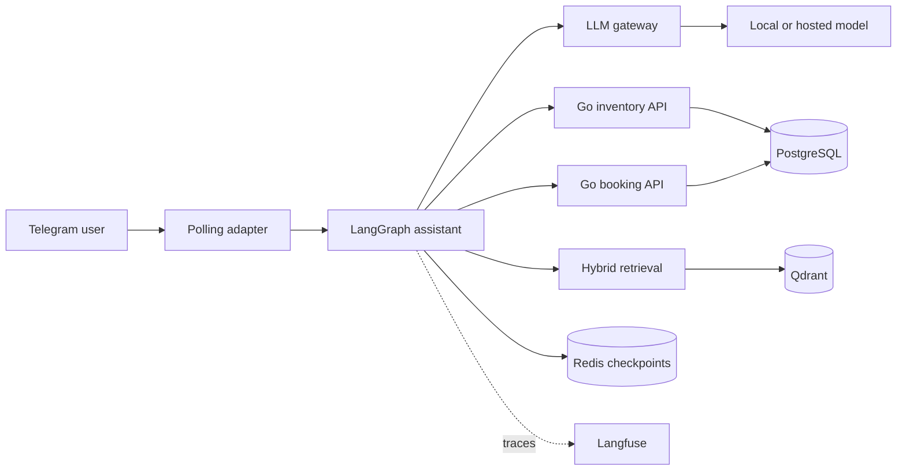

# Hotel AI

A hotel search and reservation assistant with a Telegram interface, a LangGraph
tool-calling agent, Go domain APIs, hybrid retrieval, and repeatable Langfuse
evaluations. Built as a working portfolio project with explicit system boundaries
and documented limitations.

## What it does

- Finds hotels through structured SQL search or dense/sparse hybrid retrieval.
- Retrieves authoritative hotel, room, pricing and availability data from Go APIs.
- Proposes reservations and pauses for an explicit Telegram approval or cancellation.
- Retains conversation state through Redis-backed LangGraph checkpoints.
- Routes model calls through one gateway supporting Ollama, Groq, OpenRouter and
  an OpenAI-compatible self-hosted endpoint.
- Links agent activity to Langfuse traces and evaluates fixed single/multi-turn
  scenarios with versioned deterministic scoring.

## Architecture



The model chooses tools; application code executes them. PostgreSQL owns booking
and catalog facts. Qdrant is a derived search index, not an availability ledger.
Domain rules stay in the Go services and database constraints. Read
[the architecture](docs/architecture/overview.md) and [decisions](docs/adr/README.md).

## Run locally

Requires Docker with Compose v2 and GNU Make. Commands run from the clone root.

```sh
make env
make setup
# Edit the ignored env files to configure a model provider and Telegram.
make MODEL_PROFILE= demo
```

For local Ollama, use `make demo` and explicitly install the weights as described
in [local development](docs/runbooks/local-development.md). The local port overlay
uses PostgreSQL 55432 and Redis 16379. Compose project name is `docker`; check for
collisions with an existing project before starting. Hosted inference avoids
running local model weights but still needs RAM for the application and optional
observability stack.

[Telegram setup](docs/runbooks/telegram-bot.md) covers BotFather, the allowlist and
approval buttons. The adapter uses polling; no public tunnel is needed.
The Compose credentials are local-development defaults, not deployment secrets.

## Verify and evaluate

```sh
make test                   # Go, scripted agent, gateway and evaluator tests
make test-backend-isolated  # PostgreSQL 16 binaries; isolated reservation lifecycle
make eval-agent             # Live model/backend required; read-only agent tools
make eval-retrieval         # Live indexed catalog required
```

Development tooling: Go 1.23.12, Python 3.12, uv 0.12.18, Node 22+, sqlc 1.31.1
when regenerating SQL bindings. Per-service lockfiles are versioned. Tests remain
with their owning services; cross-service contracts are under `tests/e2e/`.
See [testing](docs/runbooks/testing.md).

The eval suite contains 20 development and 5 held-out scenarios over a three-hotel
fixture. Dashboard experiments reuse the runner and a versioned TypeScript
evaluator. Operational failures are separated from answer-quality failures.
See [evaluation setup](docs/runbooks/model-evaluations.md),
[recorded results and caveats](evals/results/2026-11-22.md), and
[reading traces](docs/runbooks/langfuse-demo.md).

## Repository map

| Path | Responsibility |
| --- | --- |
| `services/` | Go inventory and reservation APIs, SQL/migrations, package tests |
| `ai/` | Agent, model gateway and hybrid retrieval |
| `integrations/` | Telegram adapter and optional MCP facades |
| `evals/` | Datasets, runners, scoring, dashboard webhook and reviewed summaries |
| `tests/e2e/` | Explicitly enabled cross-service contract checks |
| `infra/` | Local Compose, env templates, seed data and API request examples |
| `docs/` | Architecture, decisions and operating runbooks |

Learning notes, planning, experimental multi-agent/GraphRAG implementations and
unverified cloud deployment blueprints have moved to the companion
**hotel-ai-lab** repository. They are not application dependencies.

## Scope and remaining work

This is a local prototype, not a verified production deployment. Remaining work
includes durable booking idempotency, atomic booking/audit writes, approval
delivery durability, customer authorization and authoritative price validation.
Telegram pending approvals are process-local. There is no payment integration.
Read-only evals do not exercise real booking approval or writes; backend
integration tests cover a different layer. Small eval results are preliminary,
not a production-readiness or general model-ranking claim.

See [contributing](CONTRIBUTING.md) and [security](SECURITY.md).
