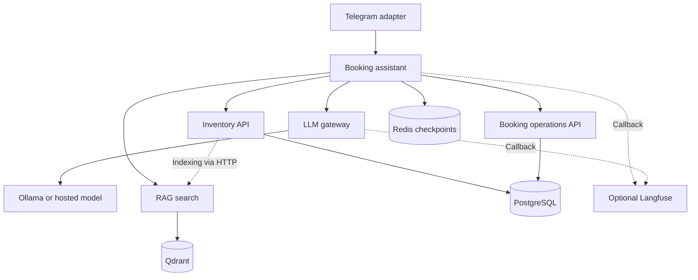

# Current architecture

The product path is Telegram → booking-assistant → model gateway and domain APIs.
The assistant is a three-node ReAct graph (`agent`, `tools`, `human_approval`).
MCP adapters provide an optional interface for external clients. Alternative
multi-agent and knowledge-graph implementations live in the companion hotel-ai-lab repository.

## Ownership and execution

- `services/hotel-inventory`: catalog, rooms, SQL-backed text/structured search.
- `services/booking-ops`: guests, reservations, availability and audit records.
- `ai/booking-assistant`: conversation state, model tool selection, interrupt/resume.
- `ai/llm-gateway`: LiteLLM routing, provider errors and token/cost accounting.
- `ai/rag-pipeline`: local FastEmbed dense BGE + sparse BM42 embeddings and Qdrant
  rank fusion. Indexing reads catalog data through the inventory HTTP API.
- `integrations/telegram-bot`: polling, allowlist, stable conversation IDs, buttons.
- `integrations/mcp`: optional thin HTTP facades for external MCP clients.

The model proposes tool names/arguments; Python executes them. Domain APIs own
relational writes. Database constraints enforce overlapping-room protection when
migrations have been applied. Prompts are guidance, not transactional guarantees.

Redis checkpoints retain graph state; in-memory fallback only survives within a
process. Each new user message resets the model-step budget, while approval
resume continues the existing turn. Telegram pending-approval tracking remains
process-local even when graph checkpoints are durable.

## Reliability work remaining

- Durable booking idempotency and approval delivery handling.
- Atomic booking/audit writes and reliable event publication if required.
- Authoritative price and cross-service entity validation.
- Customer authentication/authorization beyond a Telegram demo allowlist.
- Shared trace context across HTTP services and trace data redaction.
- More representative multi-turn, grounded-answer and failure evals.

Cloud deployment blueprints are archived in hotel-ai-lab. The application here
is verified locally; no cloud deployment or production-readiness claim is made.

Read-only eval requests carry a per-turn `read_only` flag. A server-side allowlist
blocks mutation tools, and trace entries include call IDs plus blocked/failed
status and operational/input error categories. Normal Telegram requests retain
the production approval path. This evaluation mode is not production customer
authorization or durable booking idempotency.
